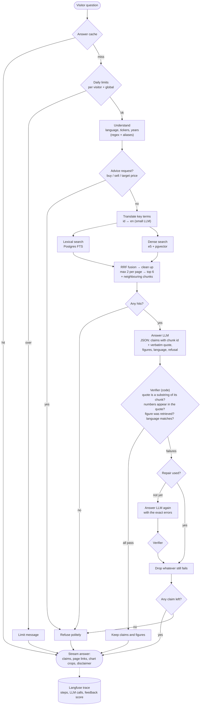
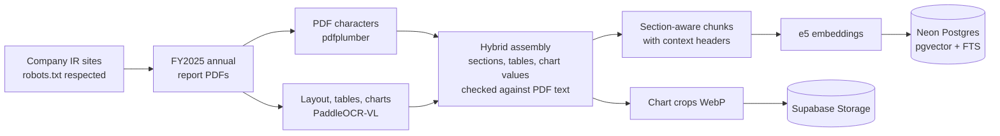

# Tanya Emiten

Ask questions about Indonesian listed companies in Bahasa Indonesia or English, and get answers taken from their
annual reports. Every claim cites a page and quotes the report word for word, and charts come with an image of the
original. The assistant refuses when the reports don't support an answer, and it never gives buy/sell advice.

**Live demo:** [tanya-emiten.vercel.app](https://tanya-emiten.vercel.app) · API on a Hugging Face Space
([health](https://rifqih-tanya-emiten-api.hf.space/health)). The API sleeps when idle, so the first question can take
a minute while it wakes up.

> Not investment advice. Answers summarise what the companies' FY2025 annual reports say.

## What it does today (MVP 1)

- **Corpus:** FY2025 annual reports of 29 LQ45 companies (banks, mining, consumer, telco, tech), downloaded from
  company investor-relations sites. IDX is never scraped, and the PDFs are not re-hosted. The 16 reports still missing
  are listed in [docs/manual_downloads.md](docs/manual_downloads.md) with the reason for each.
- **Ingestion:** every page is read twice, once as the PDF's own characters and once by PaddleOCR-VL for layout. The
  two are merged into section-aware chunks, with tables and charts as their own chunks. Chart values are kept only
  when the PDF text confirms them.
- **Answers:** hybrid retrieval (Postgres full-text + multilingual-e5 vectors, fused with RRF), then one structured
  LLM call, then code checks on every quote and number before anything is shown.
- **UI:** live progress steps, citation chips, chart crops, a "how I answered" panel, and thumbs up/down feedback.
  Every answer is traced in Langfuse.

## How an answer is made

MVP 1 is a fixed, bounded pipeline: one answer call plus at most one repair. The LLM never decides what to run next;
code checks decide what the visitor sees.



How the reports get into the index:



**Next (MVP 2):** quarterly financial statements loaded into SQL tables. A LangGraph router will send each question to
`numbers` (typed tools such as `get_metric` and `compare_peers`), `reports` (the pipeline above), or `both`, with a
bounded plan-and-execute loop (at most 4 tool calls, 1 re-plan, 1 repair). From then on, numbers in answers come from
the tables, not from PDF text.

## How good is it

Full eval on 2026-11-02 ([eval/reports/eval_20261102.md](eval/reports/eval_20261102.md)): 121 owner-reviewed
questions over all 29 companies (94 answerable, 15 unanswerable, 12 investment-advice requests; 59 in Bahasa), prompt
`system.v4`.

| Retrieval (94 answerable questions) | recall@6 | recall@12 | MRR | nDCG@6 | recall@6, Bahasa |
|---|---|---|---|---|---|
| Lexical only | 0.766 | 0.862 | 0.479 | 0.371 | 0.787 |
| Dense only | 0.702 | 0.777 | 0.537 | 0.412 | 0.702 |
| **Hybrid** | **0.862** | **0.947** | **0.653** | **0.506** | **0.787** |

| Answers (121 questions) | Result | Target |
|---|---|---|
| Refuses unanswerable questions | 100% | ≥ 90% |
| Refuses investment-advice requests | 100% | 100% |
| Answers the answerable questions | 78% | higher is better |
| Cites an expected page (answerable questions) | 63% | |
| Shown quotes that passed the verifier | 100% (enforced in code) | 100% |
| Answers that needed a repair round | 17% | |
| Latency, answered questions, run locally | median 3.0 s, p95 6.1 s | |

Most answerable questions it refuses are retrieval misses: the expected "financial highlights" page ranks 7th to
12th, just outside the top 6. On the live Space an answer currently takes 10–17 s: the LLM call is 1–2 s, and most
of the rest is database round trips between the Space and the Postgres region.

## Stack (all free tiers)

| Part | Choice |
|---|---|
| LLM | Gemini (flash-lite models) behind a provider adapter |
| OCR / layout | PaddleOCR-VL (hosted API) |
| Embeddings | `intfloat/multilingual-e5-small` (384 dims), baked into the API image |
| Database | Neon Postgres with pgvector and full-text search |
| Images | Supabase Storage |
| API | FastAPI with server-sent events, Docker on a Hugging Face Space |
| Web | Next.js + Tailwind CSS on Vercel |
| Observability | Langfuse |
| CI | GitHub Actions: lint, tests, image build and smoke test; weekly keep-alive |

## Repository layout

```
backend/            API, retrieval, answer pipeline, verifier, LLM adapters, tracing
backend/ingest/     fetch, PDF + OCR parsing, hybrid assembly, chunking, embedding
prompts/            versioned system prompts (system.v4.md is live)
eval/golden.jsonl   118 owner-reviewed questions with expected pages
web/                Next.js chat UI
tests/              pytest suite
docs/               free-tier limits, Phase 0 findings, work tracker
TANYAEMITEN.md      full project spec and decision log
```

## Running it locally

Needs Python 3.12 with [uv](https://docs.astral.sh/uv/), and Node 20+ for the UI. Copy `.env.example` to `.env` and
fill in the keys; each one says where to get it.

```bash
uv sync
```

```bash
uv run python run.py migrate
```

```bash
uv run python run.py fetch
```

```bash
uv run python run.py ingest
```

```bash
uv run python run.py index
```

```bash
uv run python run.py ask "Berapa rasio NPL BBCA tahun 2025?"
```

```bash
uv run python run.py eval --answers
```

```bash
uv run uvicorn backend.api:app --port 7860
```

For the UI, set `NEXT_PUBLIC_API_URL` in `web/.env.local`, then:

```bash
cd web && npm install && npm run dev
```

Run the tests with `uv run pytest` and the linter with `uv run ruff check .`.
